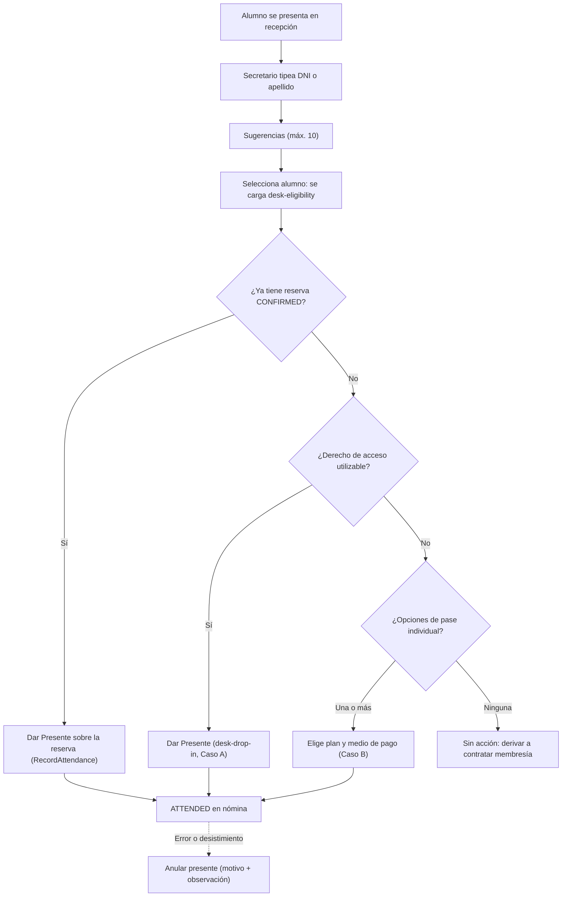
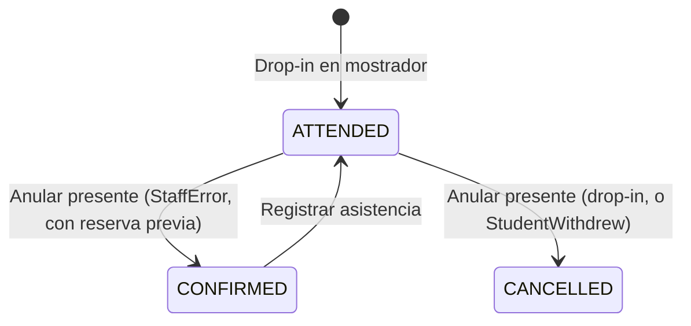

# Technical Design: Configuración de Reserva por Actividad y Check-in Rápido en Mostrador

## Contexto y Visión General

La arquitectura actual de SmartGym trata a todas las actividades de forma homogénea asumiendo que el alumno debe autogestionar una reserva online previa. En el portal de recepción (`StaffPortalComponent`), la inscripción en mostrador obliga a pegar el `Guid` del alumno, no existe un flujo de ingreso con cobro in situ y una asistencia registrada (`ATTENDED`) no puede corregirse.

Este diseño:
1. Permite definir por actividad si opera con reserva previa obligatoria o con ingreso presencial por orden de llegada (*Drop-in*).
2. Elimina el uso de GUID en recepción, incorporando un buscador de personas y una ficha de elegibilidad por clase.
3. Agrega un Check-in Directo atómico que consume el derecho de acceso existente o cobra un pase individual cuyo precio proviene de un plan configurado.
4. Agrega la anulación del presente con motivo, restitución del derecho y trazabilidad.

### Decisiones clave

| # | Decisión | Motivo |
|---|----------|--------|
| D1 | Ventana de drop-in: `[StartsAtUtc - CheckInOpensMinutesBeforeStart, EndsAtUtc)` | Definido por negocio: se puede ingresar hasta que la clase termina. |
| D2 | Precio del pase = precio de un `MembershipPlan` elegible (`IsSingleClassPass` o no ilimitado con 1 crédito); el importe nunca viaja desde el cliente | Evita que recepción defina importes y reutiliza el catálogo de planes. |
| D3 | El cobro in situ emite un `SingleClassTicket` (no contrata una membresía) | Contratar una membresía de 1 crédito chocaría con las reglas de solapamiento cuando el alumno ya tiene una membresía activa sin saldo. El plan actúa sólo como catálogo de precio. |
| D4 | `ATTENDED` deja de ser terminal sólo para la operación explícita de anulación | Corregir errores de recepción y desistimientos del alumno. |
| D5 | Anular el presente restituye el derecho de acceso, salvo `StaffError` sobre una reserva previa (vuelve a `CONFIRMED` y la reserva sigue reteniendo su derecho) | El alumno no tomó la clase; en el error de operador la reserva original sigue vigente. |
| D6 | El reembolso del dinero de un pase cobrado no es automático | Las devoluciones pertenecen a `payments` (tope, idempotencia y auditoría financiera ya resueltos allí). |
| D7 | Drop-in, ficha de elegibilidad y anulación usan `RequireStaff` (Secretario/Administrador) | La búsqueda de personas ya es `RequireStaff` y un instructor no cobra. El instructor sigue registrando asistencia de alumnos con reserva. |
| D8 | `AttendanceSource.DeskDropIn = 4` | El valor 3 ya corresponde a `SelfCheckIn`. |
| D9 | Con `RequiresBooking = false` se rechazan reservas y lista de espera para **cualquier** origen | Modalidad coherente: el único ingreso es el drop-in. |
| D10 | Las sugerencias del buscador no traen datos de membresía; esos datos se cargan al seleccionar, vía `desk-eligibility` | Evita N consultas de membresía por búsqueda y mantiene `people` desacoplado de `memberships`. |

---

## 1. Modelo de Datos (PostgreSQL)

### 1.1 `Activities`
```sql
ALTER TABLE "Activities" ADD COLUMN "RequiresBooking" BOOLEAN NOT NULL DEFAULT TRUE;
```
- `Activity`: `public bool RequiresBooking { get; private set; } = true;`, parámetro opcional `requiresBooking = true` en el constructor y método `SetRequiresBooking(bool)`. (La entidad no tiene fábrica `Create`: se usa el constructor.)
- Configuración EF con `HasDefaultValue(true)` para que las filas existentes queden en `true`.

### 1.2 `MembershipPlans`
```sql
ALTER TABLE "MembershipPlans" ADD COLUMN "IsSingleClassPass" BOOLEAN NOT NULL DEFAULT FALSE;
```
- Regla de elegibilidad como opción de pase para una sesión:
  `plan.IsActive && plan.Price > 0 && plan.AllowsActivity(session.ActivityId) && (plan.IsSingleClassPass || (!plan.IsUnlimited && plan.Credits == 1))`.

### 1.3 `Reservations`
- `IsDropIn BOOLEAN NOT NULL DEFAULT FALSE`: identifica la reserva creada por Check-in Directo. Se conserva aunque se anule el presente.
- `AttendanceRevokedAtUtc TIMESTAMPTZ NULL`, `AttendanceRevokedByUserId UUID NULL`, `AttendanceRevocationReason INT NULL`, `AttendanceRevocationNotes VARCHAR(500) NULL`.
- El índice `UX_Reservations_Active_Session_Student` no se modifica. La regla "no registrar dos veces al mismo alumno" para `ATTENDED` se valida bajo el bloqueo de la sesión.

### 1.4 Enumeraciones
- `AttendanceSource`: `DeskDropIn = 4`.
- `ReservationCancellationSource`: `AttendanceRevoked` (siguiente valor libre).
- Nuevo `AttendanceRevocationReason { StaffError = 1, StudentWithdrew = 2 }`.
- `ReservationErrorCodes`: `BOOKING_NOT_REQUIRED`, `DROP_IN_WINDOW_CLOSED`, `ALREADY_CHECKED_IN`, `SINGLE_CLASS_PLAN_NOT_AVAILABLE`, `ATTENDANCE_REVOCATION_WINDOW_CLOSED`.

---

## 2. Backend (.NET 9)

### 2.1 Catálogo de Actividades
- `ActivityListItemDto`, `ActivityDetailDto`, `PublicActivityDto`: `bool RequiresBooking`.
- `CreateActivityRequest`, `UpdateActivityRequest`: `bool RequiresBooking = true`.
- `ActivityService` mapea y persiste; el cambio queda en la auditoría existente de la actividad.

### 2.2 Planes de Membresía
- DTOs y requests de `/api/membershipplans`: `bool IsSingleClassPass = false`.

### 2.3 Reservas: modalidad sin reserva previa
- `CreateReservationAsync` y `JoinWaitlistAsync`: con la sesión bloqueada y cargada, si `session.Activity.RequiresBooking == false` → `ConflictException.WithCode(BOOKING_NOT_REQUIRED, "Esta actividad no admite reservas previas. El ingreso es directo en recepción por orden de llegada.")`. Aplica a cualquier origen (el origen se deriva del rol, no del request).
- `GetAvailableClassesAsync`: `ReservableClassSessionDto` incorpora `bool RequiresBooking`; si es `false`, `CanReserve = false`, `CanJoinWaitlist = false` e `IneligibilityReasons` incluye `BOOKING_NOT_REQUIRED`.

### 2.4 Ficha de elegibilidad en mostrador
`GET /api/reservations/desk-eligibility?classSessionId={id}&studentId={id}` (`RequireStaff`, sin efectos):
```csharp
public record DeskEligibilityDto(
    Guid StudentId, string FullName, string? DocumentNumber, string? PhotoUrl, PersonStatus PersonStatus,
    IReadOnlyList<DeskMembershipSummaryDto> ActiveMemberships, // plan, créditos disponibles, ilimitada, vencimiento
    bool HasUsableAccessRight, ReservationAccessType? SuggestedAccessType,
    IReadOnlyList<IneligibilityReasonDto> IneligibilityReasons,
    Guid? ExistingReservationId, ReservationStatus? ExistingReservationStatus,
    bool IsWithinDropInWindow, bool HasAvailableSpots, bool RequiresBooking,
    bool CanCheckIn, bool CanChargeSingleClass, bool CanEnrollReservation,
    IReadOnlyList<SingleClassPlanOptionDto> SingleClassPlanOptions); // PlanId, Name, Price
```
- Reutiliza `ReservationAccessResolver.ResolveAsync` en modo evaluación (sin consumo).
- `CanEnrollReservation`: la clase es futura, está `Open`, la actividad requiere reserva y el alumno es elegible.
- Si el alumno ya tiene una reserva `CONFIRMED` en la sesión, la UI ofrece "Dar Presente" sobre esa reserva usando el `RecordAttendanceAsync` existente, en lugar del drop-in.

### 2.5 Check-in Directo (`POST /api/reservations/desk-drop-in`)
```csharp
public record DeskDropInRequest(
    Guid ClassSessionId,
    Guid StudentId,
    bool ChargeSingleClassTicket = false,
    Guid? SingleClassPlanId = null,      // obligatorio si ChargeSingleClassTicket
    PaymentMethod? PaymentMethod = null, // obligatorio si ChargeSingleClassTicket; sólo medios manuales
    string? Notes = null);
// Header opcional: Idempotency-Key
```
`ReservationService.CheckInDeskDropInAsync`, en **una** transacción:
1. Bloquea la `ClassSession` (orden único de bloqueos). Busca la `Idempotency-Key` (por alumno) antes de validar: si existe para la misma sesión, devuelve la reserva con `200 OK`; si existe para otra sesión, responde `409 IDEMPOTENCY_KEY_MISMATCH`.
2. La sesión existe, está activa, su estado es `Scheduled` u `Open` y su actividad está `ACTIVE` (si no, `409 CLASS_NOT_OPEN`).
3. `now ∈ [StartsAtUtc - CheckInOpensMinutesBeforeStart, EndsAtUtc)` (si no, `409 DROP_IN_WINDOW_CLOSED`).
4. El alumno cumple las validaciones de persona de "Validaciones para crear una reserva" (estado, rol, edad, documentación).
5. No existe reserva `PENDING`/`CONFIRMED`/`WAITLISTED` (`409 ALREADY_RESERVED`; la UI debe usar la asistencia sobre esa reserva) ni `ATTENDED` (`409 ALREADY_CHECKED_IN`) del alumno en la sesión.
6. `ReservedCount < Capacity` (si no, `409 CLASS_FULL`). No hay lista de espera en el drop-in.
7. Bloquea las membresías del alumno.
8. **Caso A** (`ChargeSingleClassTicket = false`): `ResolveAsync` + `ConsumeAsync` (membresía con crédito, ilimitada con movimiento 0, crédito compensatorio o pase existente). Sin derecho → `409 NO_ACCESS_RIGHT` con los motivos.
9. **Caso B** (`ChargeSingleClassTicket = true`):
   - Valida que `SingleClassPlanId` sea una opción elegible para la sesión (si no, `409 SINGLE_CLASS_PLAN_NOT_AVAILABLE`) y que `PaymentMethod` sea manual (`Cash`, `BankTransfer`, `CreditCard`, `DebitCard`, `Other`; los proveedores externos quedan fuera).
   - Registra el `Payment` (`PayerPersonId = StudentId`, `ClassSessionId`, `Amount = plan.Price`, `Status = Completed`, notas con el nombre del plan) mediante `IPaymentService`, y el movimiento `SingleClassTicket` mediante `ICreditLedgerService`. Ambos se ejecutan dentro de la transacción ambiente; si hace falta, se agregan variantes que no abran ni confirmen su propia transacción.
   - `AccessType = SingleClassTicket`, `PaymentId`, `SingleClassTicketMovementId`.
10. Crea la reserva con `Reservation.CreateDropInAttended(...)`: `Origin = StaffDesk`, `IsDropIn = true`, `Status = Attended`, `AttendedAtUtc = now`, `AttendanceSource = DeskDropIn`, `CheckedInByUserId = CreatedByUserId = staffUserId`, y una transición `null → ATTENDED` en `ReservationStatusChanges` (`Trigger = StaffAction`).
11. `IncrementReservedCount()` + `IncrementAttendedCount()`.
12. Auditoría `RESERVATION_DESK_DROP_IN` (con `SingleClassPlanId` y `PaymentId` si corresponde) y commit. Cualquier fallo revierte pago, movimiento y reserva.

### 2.6 Anulación del presente (`POST /api/reservations/{id}/revoke-attendance`)
```csharp
public record RevokeAttendanceRequest(AttendanceRevocationReason Reason, string Notes); // Notes obligatoria, máx. 500
```
`ReservationService.RevokeAttendanceAsync`, en una transacción con bloqueo de sesión y membresías:
1. La reserva existe y está `ATTENDED` (si no, `409 INVALID_STATE_TRANSITION`).
2. Plazo: `StudentWithdrew` sólo mientras `now < EndsAtUtc`; `StaffError` hasta `EndsAtUtc + AttendanceRegistrationHoursAfterEnd`. Fuera de plazo → `409 ATTENDANCE_REVOCATION_WINDOW_CLOSED`.
3. Efectos (siempre `DecrementAttendedCount()` y se completan los campos `AttendanceRevoked*`):

| Tipo de reserva | Motivo | Estado final | Cupo | Derecho de acceso |
|---|---|---|---|---|
| Drop-in (`IsDropIn`) | cualquiera | `CANCELLED` (`CancellationSource = AttendanceRevoked`, `IsLateCancellation = false`) | `DecrementReservedCount()` | Restituido |
| Con reserva previa | `StaffError` | `CONFIRMED` (se limpian `AttendedAtUtc`, `AttendanceSource`, `CheckedInByUserId`) | Sin cambios | Sigue retenido por la reserva |
| Con reserva previa | `StudentWithdrew` | `CANCELLED` (`AttendanceRevoked`) | `DecrementReservedCount()` | Restituido |

   - "Restituido" significa: devolución del crédito vía `ICreditLedgerService.RefundCreditForReservationAsync` (a lo sumo una por reserva), liberación del pase o del crédito compensatorio, o anulación del canje promocional, igual que en una cancelación anticipada.
   - No se promueve la lista de espera: la clase ya está en la ventana de ingreso.
   - Si la reserva tenía `PaymentId`, la respuesta lo informa para que recepción gestione el reembolso desde `payments`.
4. Transición en `ReservationStatusChanges` (`Trigger = StaffAction`, motivo y notas) y auditoría `RESERVATION_ATTENDANCE_REVOKED`.
5. Se publica el evento de cancelación con `CancellationSource = AttendanceRevoked`. El handler de notificaciones no notifica al alumno para esta fuente.

### 2.7 Búsqueda de alumnos
- Se reutiliza `GET /api/people?search=&role=Student&status=ACTIVA&pageSize=10` (ya busca por nombre, apellido, documento y email, y es `RequireStaff`). No requiere cambios de backend.

---

## 3. Frontend (Angular)

### 3.1 Catálogo de actividades
- `Activity` (TS) con `requiresBooking: boolean`.
- `ActivityFormModalComponent`: checkbox `requiresBooking` (inicial `true`) con la leyenda "¿Requiere reserva previa online?" y una ayuda.
- `activities-management` y `activities` (pública): insignia "Con reserva previa" / "Acceso libre sin reserva".

### 3.2 Planes de membresía
- Formulario de planes: checkbox "Disponible como pase de clase individual en recepción" (`isSingleClassPass`). Ayuda: los planes de 1 crédito no ilimitados también se ofrecen automáticamente.

### 3.3 Portal del Alumno
- Si `requiresBooking === false`: sin botones "Reservar" ni "Lista de espera", con la insignia `ℹ️ Acceso libre por orden de llegada (ingreso en recepción)`.

### 3.4 Portal de Recepción (`StaffPortalComponent`)
- Se elimina el input "ID del alumno (Guid)" y el input "Guid de la membresía" (créditos compensatorios); este último se reemplaza por un selector de membresías del alumno elegido con el buscador.
- **Buscador**: input con debounce de 300 ms (mínimo 2 caracteres), hasta 10 sugerencias con foto, nombre completo, DNI y estado de la persona. Navegable con teclado.
- **Ficha** (al seleccionar el alumno, con una clase seleccionada): datos de `desk-eligibility`.
- **Acciones**:
  - `[✓ Dar Presente]`: si `canCheckIn`. Si el alumno ya tiene una reserva `CONFIRMED`, registra la asistencia sobre esa reserva; si no, llama a `desk-drop-in`.
  - `[💳 Cobrar Pase y Dar Presente]`: si `canChargeSingleClass`. Muestra las opciones de plan con su precio (si hay una sola, preseleccionada) y el medio de pago; envía `Idempotency-Key` y deshabilita el botón mientras procesa.
  - `[📋 Inscribir Reserva]`: si `canEnrollReservation`.
  - `[Limpiar selección]`.
- **Nómina**: cada fila `ATTENDED` ofrece "Anular presente" (sólo personal) con un diálogo de motivo y observación obligatoria. Tras cualquier acción se refrescan la nómina y los contadores sin recargar la página.
- Las acciones de mostrador se ocultan para el rol Instructor sin rol de personal.

---

## 4. Flujos





---

## 5. Riesgos y Mitigaciones
- **Atomicidad entre módulos** (`payments`, `memberships`, `reservations`): todo dentro de la transacción ambiente; tests de integración que fuercen fallas en el pago y en el ledger y verifiquen que no quede nada persistido.
- **Doble cobro**: `Idempotency-Key` + botón deshabilitado durante la solicitud.
- **Abuso de la anulación**: motivo y observación obligatorios, plazos acotados, sólo personal, auditoría.
- **Changes previos sin archivar**: `date-format-and-student-booking-filters` modifica "Consulta eficiente de clases disponibles". Por eso este change agrega un requisito nuevo en lugar de modificar ese. Conviene archivar los changes completos antes de archivar este.
